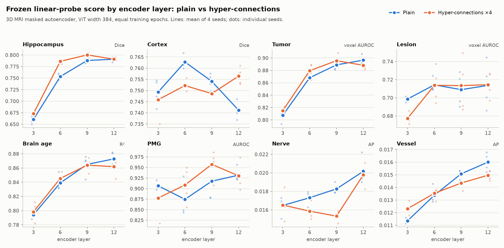

# Results: hyper- and frac-connections in a 3D MRI masked autoencoder

Small-scale experiments with the connections in this repo, run in October 2026. Everything is
paired by seed against a plain pre-norm baseline. Numbers are means over 4 seeds, and "seeds
better" counts seeds where the variant beat its paired baseline seed.

## Setup

- **Model.** A masked autoencoder for 3D brain MRI.
  - Encoder: ViT, 12 blocks, width 384 (6 heads); a width-512 run is noted under speed.
  - Patches: 8×8×8 voxels on a 192×240×192 1 mm grid.
  - Masking: 1,280 visible and 1,280 predicted patches per sequence, 2 sequences per scan, 32 scans per step.
  - Decoder: 4 blocks × 512, plain residuals.
  - Loss: MSE on per-patch normalized voxels.
- **Training.**
  - Optimizer: Muon on the hidden weight matrices, AdamW on the rest; lr 3e-3, weight decay 0.05.
  - Schedule: a 40-epoch cosine (5 warmup epochs), cut by a 1-hour wall-clock budget, which is about 15 epochs for the plain model on one H100.
  - Precision: bf16 autocast, `torch.compile`.
- **Connections.** In the encoder only. Their parameters are on AdamW, and the static matrices get no weight decay, as in the papers. Rate 4 for both: 4 streams (hyper) and 4 fractions of 96 (frac).
- **Data.** About 46.6k 3D scans (T1w, T2w, DWI, FLAIR) from the OpenNeuro part of FOMO300K.
- **Evaluation.** The encoder is frozen and scored with linear probes on the FOMO25 tasks.
  - Patch features: hippocampus and cortex segmentation (Dice); tumor and lesion (voxel AUROC); nerve and vessel (AP).
  - Mean-pooled features: brain age (R²) and polymicrogyria (PMG, AUROC).
  - With hyper-connections, a layer's features are the sum of its streams, the same quantity the final norm sees.
- **Readouts.** "Last layer" uses block 12. "Layers 9+12" concatenates blocks 9 and 12.

## Speed and memory

The extra FLOPs are tiny: +0.9% for hyper-connections at width 512, and +0.2% for frac-connections at width 384. The cost is memory traffic. Hyper-connections keep 4 fp32 copies of every token's state and mix them twice per block. The block's own matmul work grows with width², while that stream traffic grows only with width. So at width 384–512 the traffic is comparable to the block compute; at LLM widths (2–7k) it's small, which is why the papers report a few percent.

| Model (one H100, bf16 autocast, compiled) | Step time | Throughput | Peak memory | Epochs in 1 h |
|---|---|---|---|---|
| Plain, width 384 | 0.156 s | 206 vol/s | 31.7 GB | 15 |
| Hyper-connections ×4 (dynamic), width 384 | 0.248 s (1.6×) | 129 vol/s | 56.4 GB | 9 |
| Frac-connections ×4 (dynamic), width 384 | 0.194 s (1.24×) | 166 vol/s | 39.7 GB | 11 |
| Plain, width 512 | 0.181 s | 177 vol/s | 36.8 GB | 13 |
| Hyper-connections ×4, width 512, first implementation (stored the paper's [rate+1]-stream `mix_h`) | 0.312 s (1.7×) | ~101 vol/s | 77.0 GB | ~8 (stopped) |

Rearranging the computation so `mix_h` is never stored (the version in this repo) changed the slowdown only a little. The cost is the stream traffic itself, not how the math is laid out. A fused kernel, as the mHC paper uses, or bf16 streams (`stream_dtype`) are the remaining levers.

## One-hour budget (fewer epochs for the connections)

Dynamic hyper-connections ×4 (9 epochs) against plain (15 epochs):

| Task | Plain | HC | Change | Seeds better | Layers 9+12: change | Seeds better |
|---|---|---|---|---|---|---|
| Hippocampus | .791 | .776 | −.015 | 0/4 | −.008 | 0/4 |
| Cortex | .741 | .753 | +.012 | 4/4 | +.004 | 4/4 |
| Tumor | .897 | .889 | −.007 | 0/4 | −.008 | 0/4 |
| Lesion | .714 | .733 | +.020 | 3/4 | +.022 | 4/4 |
| Age R² | .873 | .855 | −.018 | 0/4 | −.010 | 1/4 |
| Nerve | .020 | .019 | −.001 | 1/4 | −.002 | 1/4 |
| Vessel | .016 | .014 | −.002 | 0/4 | −.002 | 0/4 |
| PMG | .932 | .908 | −.023 | 1/4 | +.003 | 3/4 |

Dynamic frac-connections ×4 (11 epochs) against plain (15 epochs):

| Task | Plain | FC | Change | Seeds better | Layers 9+12: change | Seeds better |
|---|---|---|---|---|---|---|
| Hippocampus | .791 | .787 | −.004 | 1/4 | −.005 | 1/4 |
| Cortex | .741 | .744 | +.003 | 3/4 | +.002 | 3/4 |
| Tumor | .897 | .886 | −.010 | 1/4 | −.010 | 1/4 |
| Lesion | .714 | .715 | +.001 | 2/4 | +.003 | 2/4 |
| Age R² | .873 | .861 | −.012 | 2/4 | −.016 | 1/4 |
| Nerve | .020 | .019 | −.001 | 1/4 | −.002 | 1/4 |
| Vessel | .016 | .015 | −.001 | 0/4 | −.001 | 1/4 |
| PMG | .932 | .921 | −.010 | 2/4 | −.011 | 1/4 |

## Equal epochs (hyper-connections given the time to match)

The 9-epoch hyper-connection runs were resumed from their checkpoints to the baseline's own epoch count per seed: 15, 15, 15, and 12 for one seed whose baseline ran on a slower node. The lr schedule is keyed to the global step, and the optimizer state was restored, so the continuation follows the same schedule as the baseline. In a CPU check, a stopped-and-resumed run reproduced the uninterrupted run's per-step learning rate exactly.

| Task | Plain | HC | Change | Seeds better | Layers 9+12: plain | HC | Change | Seeds better |
|---|---|---|---|---|---|---|---|---|
| Hippocampus | .791 | .791 | .000 | 2/4 | .799 | .808 | **+.009** | **4/4** |
| Cortex | .741 | .756 | **+.015** | **4/4** | .764 | .772 | **+.008** | **4/4** |
| Tumor | .897 | .888 | −.008 | 1/4 | .900 | .898 | −.001 | 2/4 |
| Lesion | .714 | .714 | +.001 | 1/4 | .714 | .712 | −.003 | 1/4 |
| Age R² | .873 | .862 | −.011 | 0/4 | .874 | .871 | −.003 | 1/4 |
| Nerve | .020 | .020 | .000 | 1/4 | .020 | .019 | −.001 | 0/4 |
| Vessel | .016 | .015 | −.001 | 0/4 | .016 | .015 | −.001 | 1/4 |
| PMG | .932 | .930 | −.002 | 2/4 | .920 | .945 | **+.025** | 3/4 |

Training loss at the same epoch (mean of 4 seeds):

| | Epoch 6 | Epoch 9 | Epoch 11 |
|---|---|---|---|
| Plain | .5249 | .4258 | .4061 |
| Hyper-connections ×4 | **.5130** | **.4204** | – (9 epochs in 1 h) |
| Frac-connections ×4 | .5212 | .4224 | **.4034** |

What adding layer 9 to the last layer gains, within each model:

| Task | Plain | Hyper-connections |
|---|---|---|
| Hippocampus | +.008 | **+.017** |
| Cortex | **+.023** | +.016 |
| Tumor | +.003 | **+.010** |
| Lesion | +.001 | −.003 |
| Age R² | +.001 | **+.009** |
| PMG | −.012 | **+.015** |

## Best readout for each: the split readout

The dense tasks read layers 6+9+12 concatenated, and age and PMG pool layers 9+12. This is the plain model's best readout. Equal epochs:

| Task | Plain | HC | Change | Seeds better |
|---|---|---|---|---|
| Hippocampus | .804 | .813 | **+.010** | **4/4** |
| Cortex | .785 | .785 | .000 | 2/4 |
| Tumor | .897 | .898 | +.001 | 3/4 |
| Lesion | .715 | .715 | +.001 | 1/4 |
| Age R² | .874 | .871 | −.003 | 1/4 |
| Nerve | .018 | .019 | +.001 | 3/4 |
| Vessel | .016 | .014 | −.002 | 0/4 |
| PMG | .920 | .945 | **+.025** | 3/4 |

## Layer by layer

Each layer is probed on its own (equal epochs, 4 seeds). Cells show plain / HC (change, seeds where HC is better).

| Task | Layer 3 | Layer 6 | Layer 9 | Layer 12 |
|---|---|---|---|---|
| Hippocampus | .660 / .673 (+.013, 4/4) | .753 / .786 (**+.033, 4/4**) | .788 / .800 (+.012, 4/4) | .791 / .791 (.000, 2/4) |
| Cortex | .749 / .746 (−.003, 1/4) | .763 / .752 (−.011, 0/4) | .754 / .749 (−.005, 0/4) | .741 / .756 (**+.015, 4/4**) |
| Tumor | .808 / .815 (+.007, 3/4) | .868 / .879 (+.011, 3/4) | .889 / .896 (+.007, 3/4) | .897 / .888 (−.008, 1/4) |
| Lesion | .699 / .677 (−.021, 0/4) | .714 / .714 (−.001, 2/4) | .709 / .713 (+.004, 2/4) | .714 / .714 (+.001, 1/4) |
| Age R² | .794 / .798 (+.004, 3/4) | .839 / .845 (+.006, 3/4) | .865 / .864 (−.001, 2/4) | .873 / .862 (−.011, 0/4) |
| Nerve | .016 / .017 (.000, 1/4) | .017 / .016 (−.001, 0/4) | .018 / .015 (−.003, 0/4) | .020 / .020 (.000, 1/4) |
| Vessel | .011 / .012 (+.001, 4/4) | .013 / .014 (.000, 3/4) | .015 / .014 (−.001, 0/4) | .016 / .015 (−.001, 0/4) |
| PMG | .907 / .878 (−.029, 2/4) | .875 / .908 (**+.034, 4/4**) | .918 / .957 (**+.040, 4/4**) | .932 / .930 (−.002, 2/4) |

## What we take from it

- **Per epoch, hyper-connections learn faster.** The training loss is lower at every matched epoch, the dense anatomy probes improve (cortex +.015 last layer, hippocampus +.009 with layers 9+12, all 4 seeds), and the other tasks are about even.
- **Per hour they don't,** at width 384. The 1.6× step time costs 6 of 15 epochs, and the tasks that track training length (hippocampus, age, tumor) drop.
- **The 1-hour lesion gain was a training-length effect.** HC's lesion score was +.020 at 9 epochs, but fell back to the baseline at 15, consistent with this lesion probe dropping as pretraining runs longer.
- **Hyper-connection layers are less redundant.** Adding layer 9 helps HC more than plain on hippocampus, tumor, age and PMG. That fits the paper's observation that adjacent HC layers are less similar.
- **The middle layers carry most of the hyper-connection gain.** At layer 6 HC leads on hippocampus (+.033), tumor and PMG (+.034), on all or most seeds. HC builds useful features earlier, and the gap narrows by layer 12.
- **Cortex is the exception.** The plain model's cortex score peaks at layer 6 and falls to layer 12; HC's is flatter and ends higher. So HC's last-layer cortex gain is HC keeping that detail to the top, not better cortex features overall. Once both readouts include layer 6 (the split readout), they tie on cortex.
- **With each model's best readout, HC wins hippocampus (+.010, 4/4) and PMG (+.025, 3/4) and ties the rest.** Vessel is the only small, consistent loss (−.002, 0/4).
- **Frac-connections are cheaper but don't keep the gains.** At 11 epochs they are close to plain on every task. The cortex gain seems to need the real extra width of 4 streams.

## Next

- Static versions (SHC, SFC), and bf16 streams.
- mHC and mHC-lite (doubly-stochastic stream mixing), at equal epochs.
